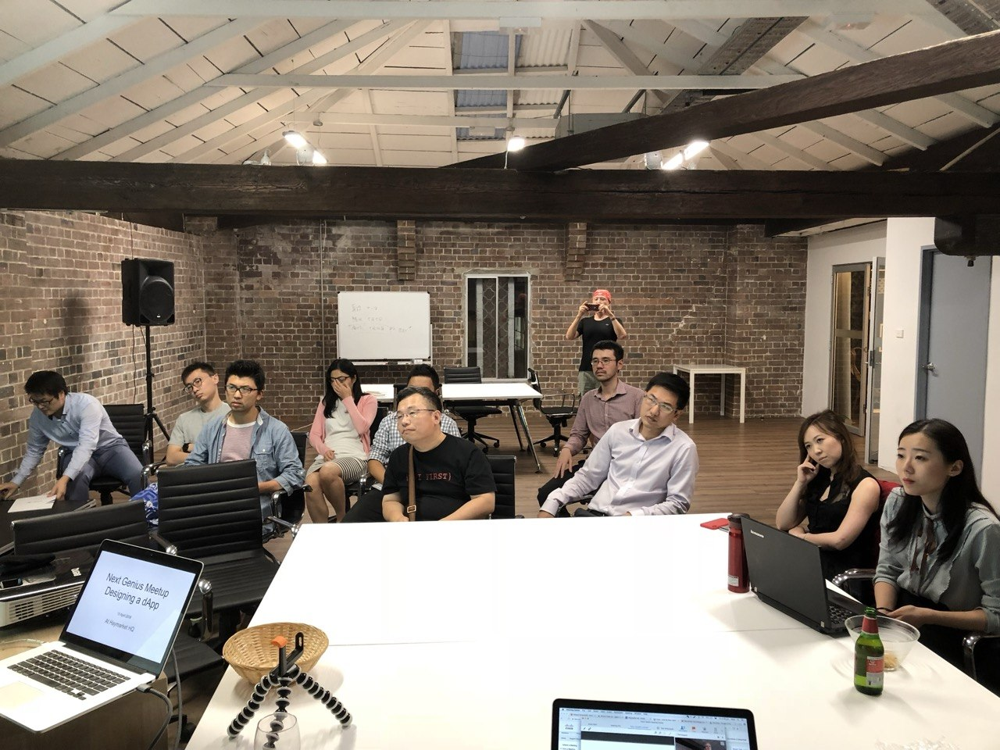

# About

> Page title tag: **About Our Business & Builder Community | NextGenius**

*ABOUT NEXTGENIUS*

## Practical delivery. Shared experience.

NextGenius combines AI consulting and digital product development with a Sydney-based community for learning, building and collaboration.

*TWO CONNECTED PARTS*

## A delivery partner and a place to build.

For Australian businesses, we help turn operational problems into scoped AI, automation and software projects. Our work starts with understanding the process and defining how improvement will be measured.
For founders, engineers and operators, our community creates opportunities to exchange implementation experience, attend workshops and explore collaborations.
These activities support each other: practical projects give learning context, and community conversations bring new perspectives to implementation.
[Discuss a project ↗](#/contact)
[Join the conversation](#/community)

*HOW WE WORK*

## Useful outcomes, with clear boundaries.

### Start with the process

Understand the users, existing tools and business need before selecting the technology.

### Make progress reviewable

Agree on scope, milestones and pilot measures so your team can assess the work.

### Build for adoption

Include documentation, training and a practical support path so the solution can be used.
