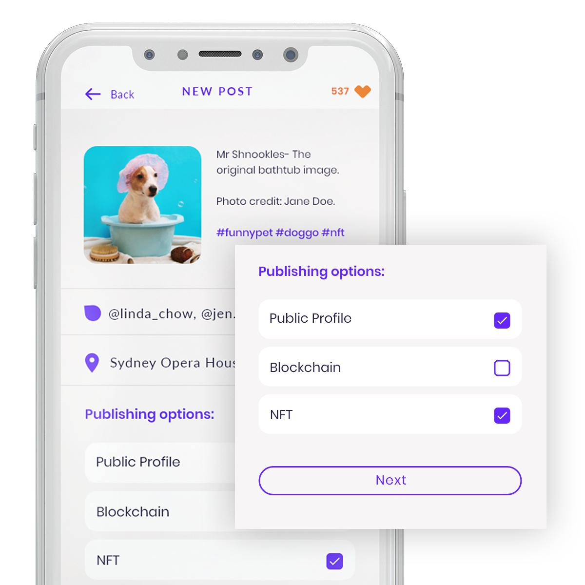
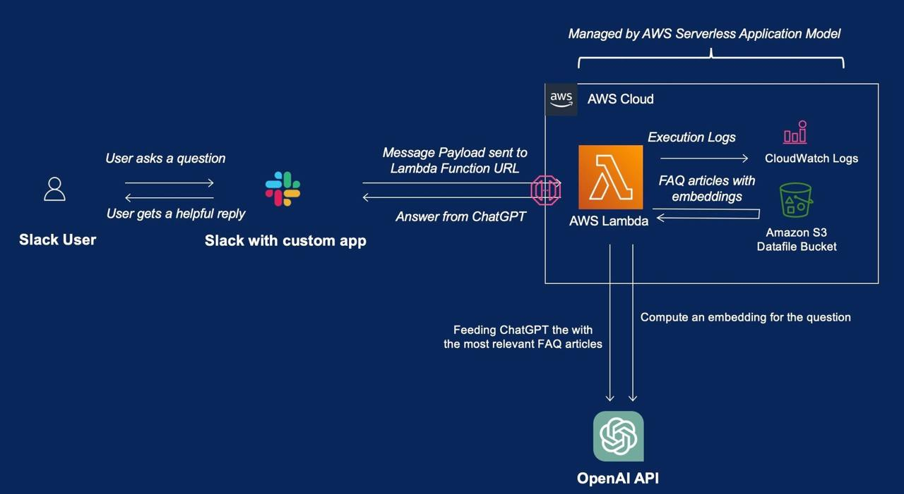
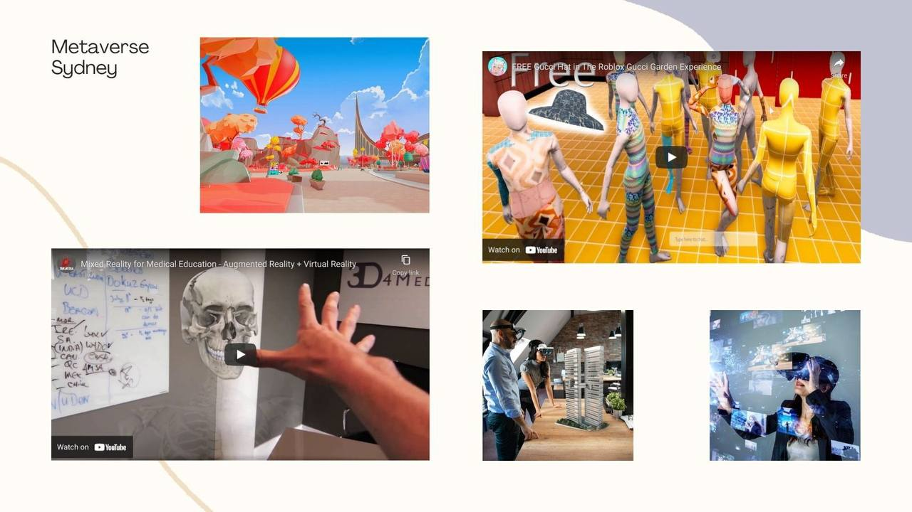
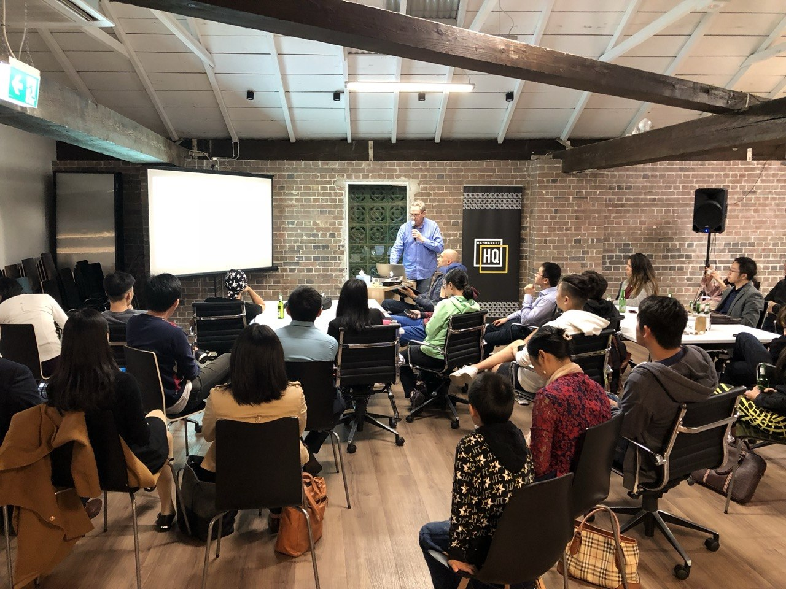

# Home

> Page title tag: **Practical AI for Australian Businesses | NextGenius**

*AI CONSULTING · AUTOMATION · SOFTWARE*

## Smarter systems.Less busywork.

We help Australian businesses automate admin, connect their systems, and turn company knowledge into useful AI assistants.
[Discuss your business ↗](#/contact)
[Explore our projects](#/use-cases)
Sydney-based · Start with one useful workflow
WHAT BETTER OPERATIONS CAN LOOK LIKE
01
Capture the request and relevant context.
02
Find information, prepare a draft and track the next step.
03
Review important decisions and exceptions.

*BUILT AROUND YOUR BUSINESS*

## Start with the work that slows you down.

Choose a focused problem. Test the improvement with your team. Expand when the value is clear.
01

### Automate everyday admin

Connect enquiries, follow-ups and routine updates so your team spends less time copying information between tools.
[Explore solutions ↗](#/service)
02

### Put your business knowledge to work

Build an assistant that helps staff search your documents, policies and procedures, with source references and clear review points.
[Explore solutions ↗](#/service)
03

### Connect the systems you already use

Bring sales, operations and service together through integrations, customer portals and internal tools built around your workflow.
[Explore solutions ↗](#/service)

*EXPLORE WHAT WE BUILD*

## See the work. Try the experience.

Explore our social and learning applications to see how we approach digital products.

Social platform

### LunchUp

A social web application with a product interface you can explore.
[View project ↗](#/use-cases)

Education platform

### STEM Learning App

A learning application and an example of the system flow behind connected digital experiences.
[View project ↗](#/use-cases)

Interactive learning demo

### AI Creative Studio

A game-like 3D studio with design challenges and a challenge, tutor and critic loop.
[View project ↗](#/use-cases)

*A CLEAR DELIVERY PATH*

## From a business problem to a working solution.

01

### Discover

Understand the process, users and bottlenecks.
02

### Scope

Agree on the workflow, success measures and boundaries.
03

### Pilot

Build, test with real users and refine.
04

### Support

Help your team adopt and improve the solution.

*BUILD YOUR ONE-PERSON BUSINESS*

## Your expertise could be your next service.

Answer five questions. Leave with a free, editable service plan.
[Create my free service plan ↗](#/opc)

*LEARN · BUILD · CONNECT*

## Business delivery, backed by a builder community.

Join practical AI workshops, meet other builders, or help shape an Australian one-person company network.
[Explore the community ↗](#/community)
[Team workshops](#/workshop)

*LET’S FIND A USEFUL FIRST STEP*

## What would you like to make easier?

Tell us about one workflow, one bottleneck or one idea.
[Request a discovery call ↗](#/contact)
