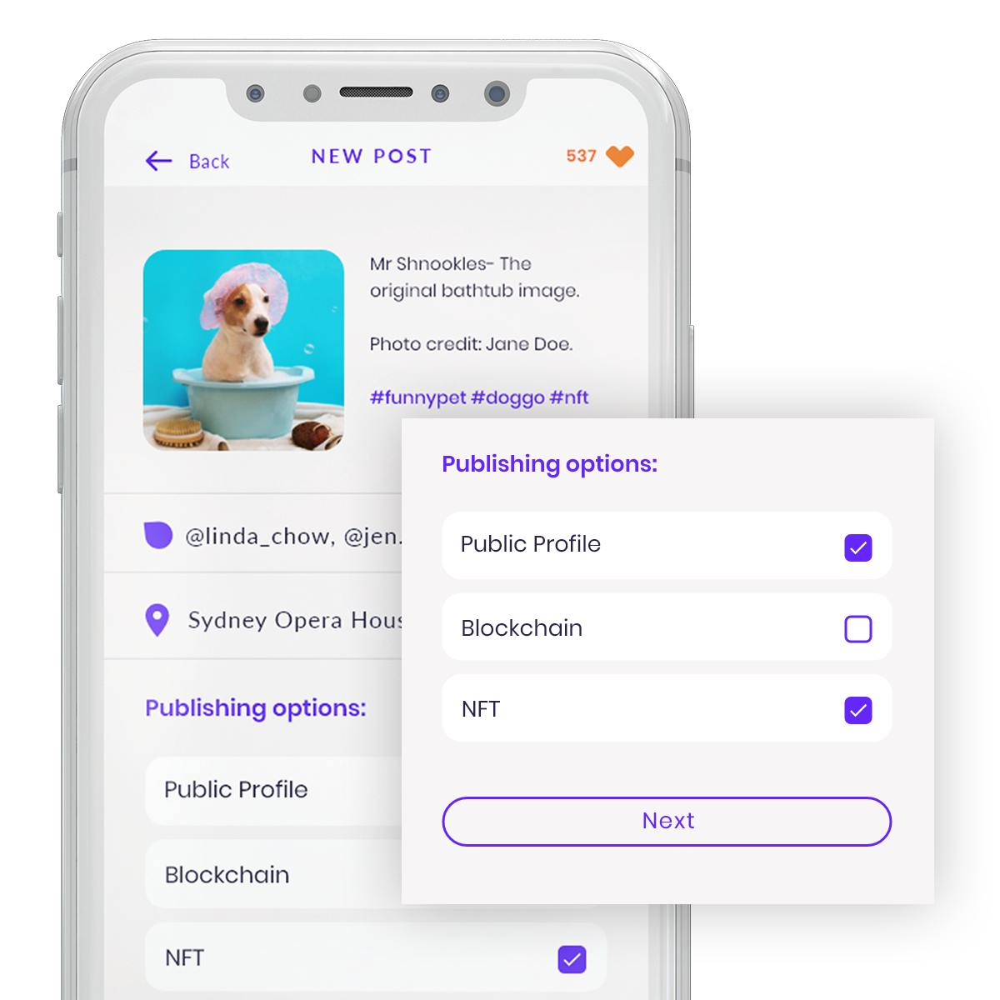
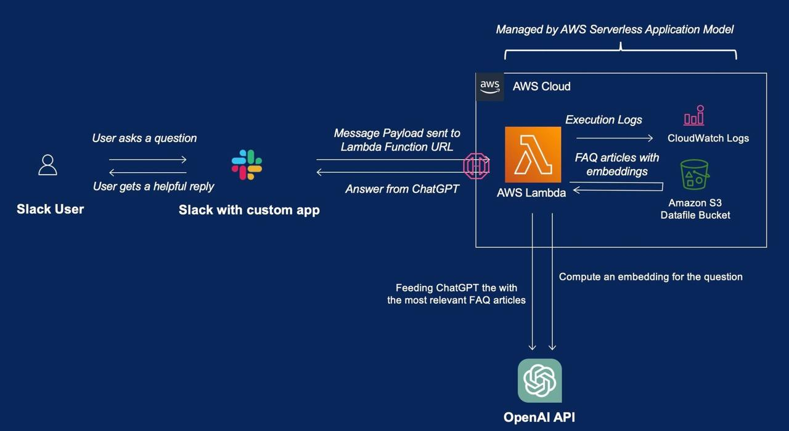
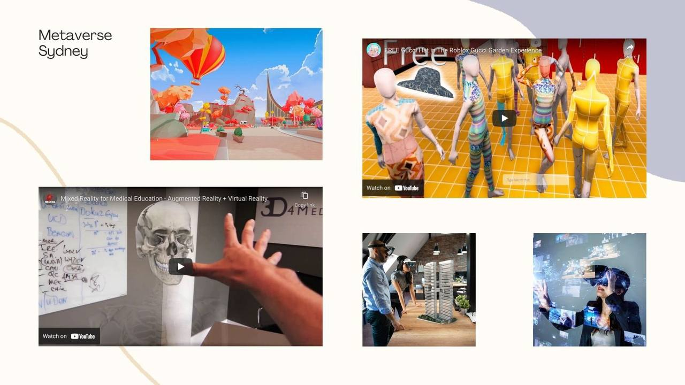

# Projects

> Page title tag: **Projects & Practical AI Use Cases | NextGenius**

*PROJECTS & USE CASES*

## Explore the work behind the words.

Try our applications, see what they are designed to do, and identify a useful starting point for your own business.

*PRODUCT SHOWCASE*

## Applications you can explore.

These examples show product experiences and implementation approaches. They are not presented as independently measured client outcomes.

Social platform

## LunchUp

Who it is for
People looking to make social connections.
The problem
Help people move from discovering a connection to arranging a shared experience.
What we built
A social web application with a product interface you can explore.
How to evaluate it
Explore the app to assess its fit. No customer growth or commercial results are claimed here.
[Explore LunchUp ↗](https://lunchup.com.au/)

Education platform

## STEM Learning App

Who it is for
Learners and educators exploring digital STEM learning.
The problem
Make learning activities and supporting systems easier to access.
What we built
A learning application and an example of the system flow behind connected digital experiences.
How to evaluate it
Use the app to explore its learning experience. Learning outcomes require separate evaluation.
[Explore the learning app ↗](https://stem.nextgenius.com.au/)

Interactive learning demo

## AI Creative Studio

Who it is for
Learners exploring design, AI and systems thinking.
The problem
Help learners practise creative problem-solving through an interactive experience.
What we built
A game-like 3D studio with design challenges and a challenge, tutor and critic loop.
How to evaluate it
Try a design challenge to explore the experience. This is a product demonstration, not a measured client case study.
[Try AI Creative Studio ↗](https://studio.nextgenius.com.au/)

*YOUR BUSINESS COULD START HERE*

## One workflow. A clear way to measure value.

### Internal knowledge assistant

Search policies, procedures and templates.
Pilot evaluation: Measure time to find an answer, source accuracy and staff adoption.
[Discuss this workflow ↗](#/contact)

### Admin & follow-up automation

Reduce copying, status chasing and missed handovers.
Pilot evaluation: Measure manual steps, turnaround time and exception rates.
[Discuss this workflow ↗](#/contact)

### Proposal & enquiry support

Prepare consistent drafts using approved business information.
Pilot evaluation: Measure preparation time, review effort and correction rates.
[Discuss this workflow ↗](#/contact)
