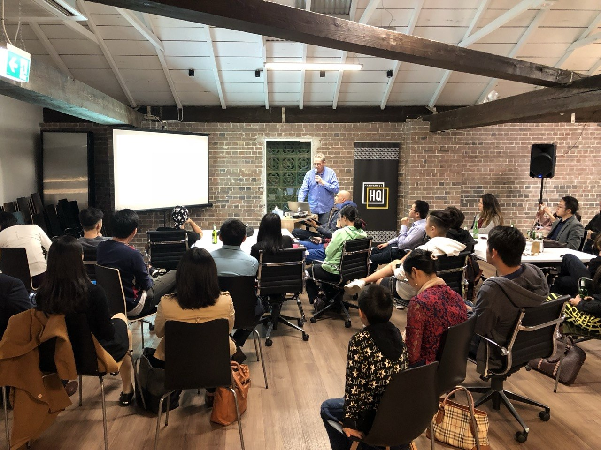
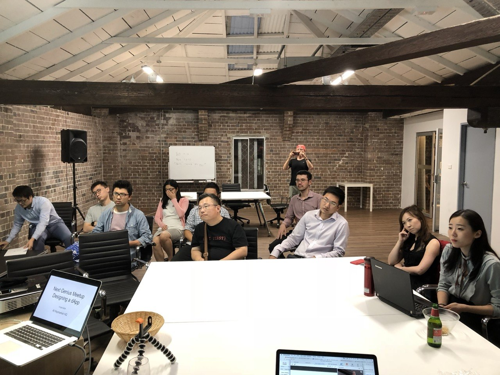
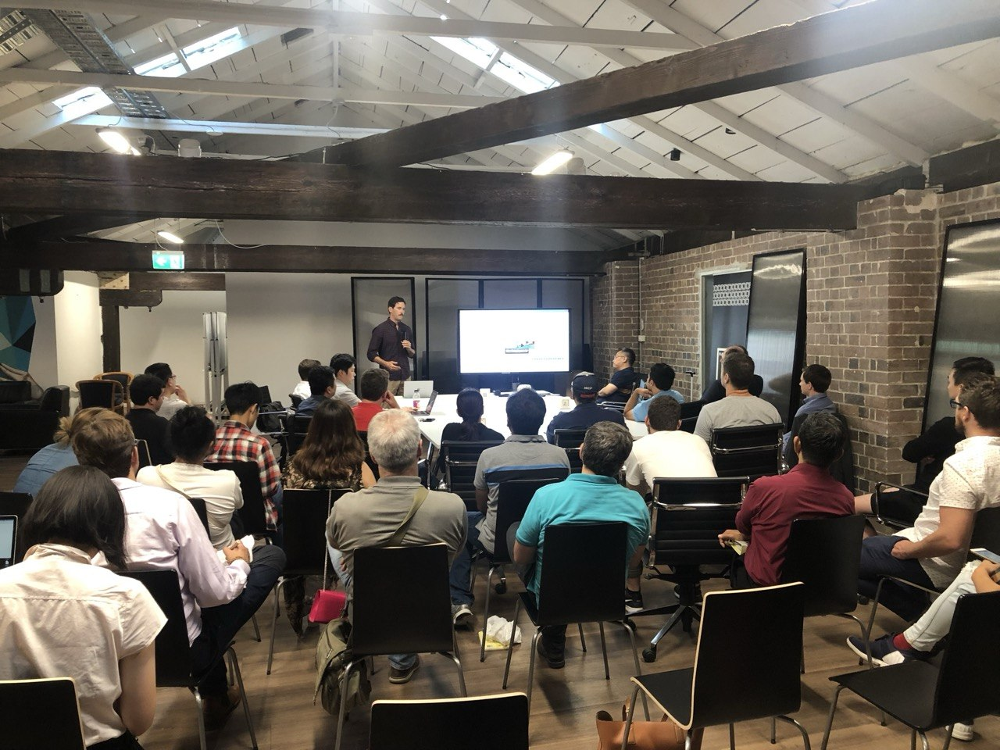
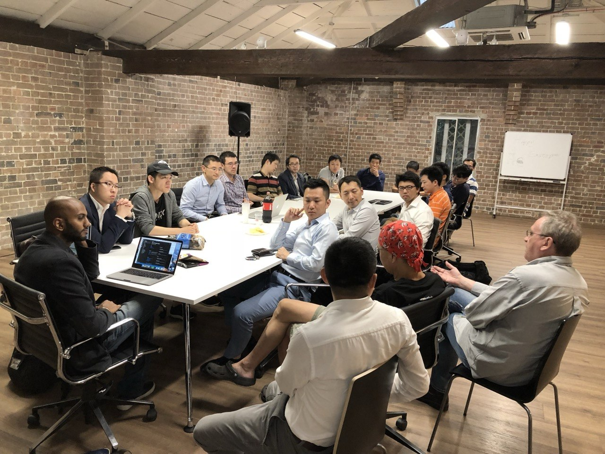
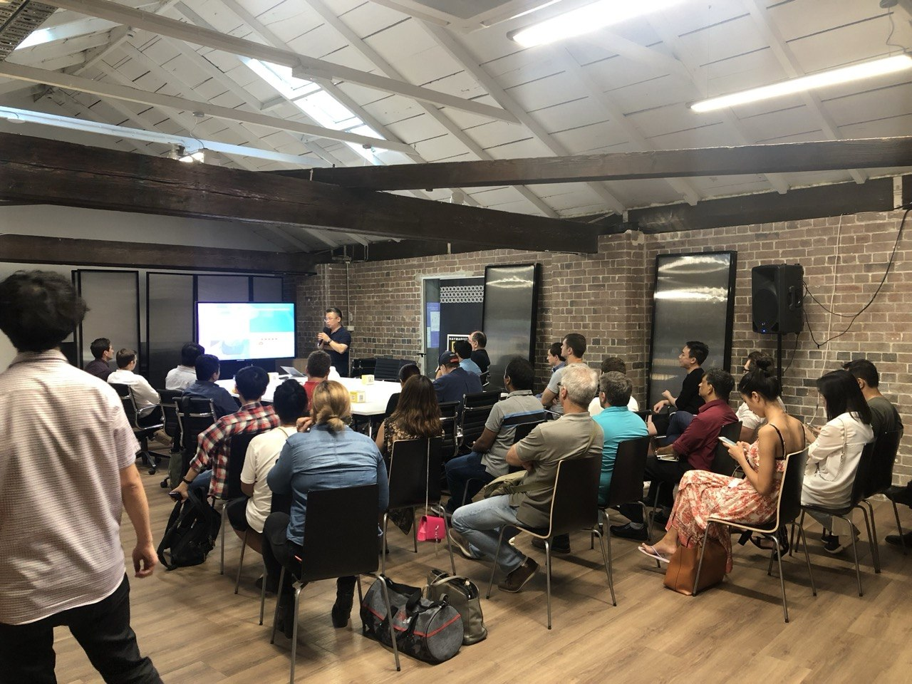
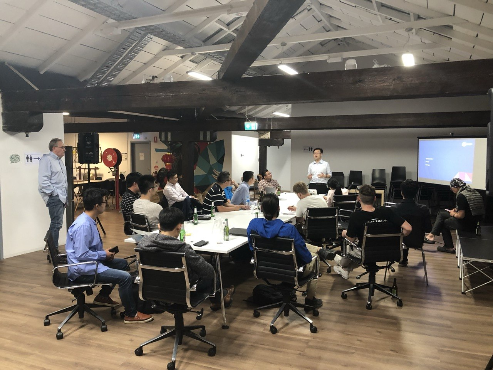
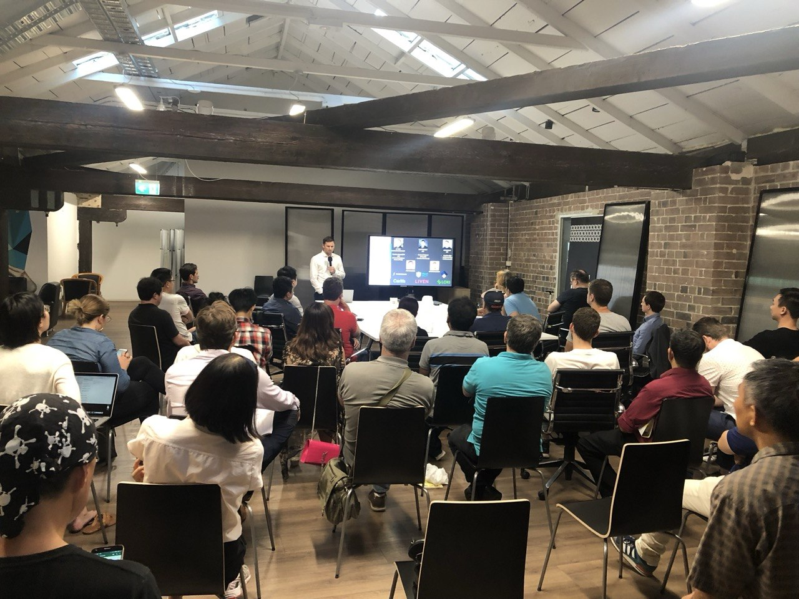
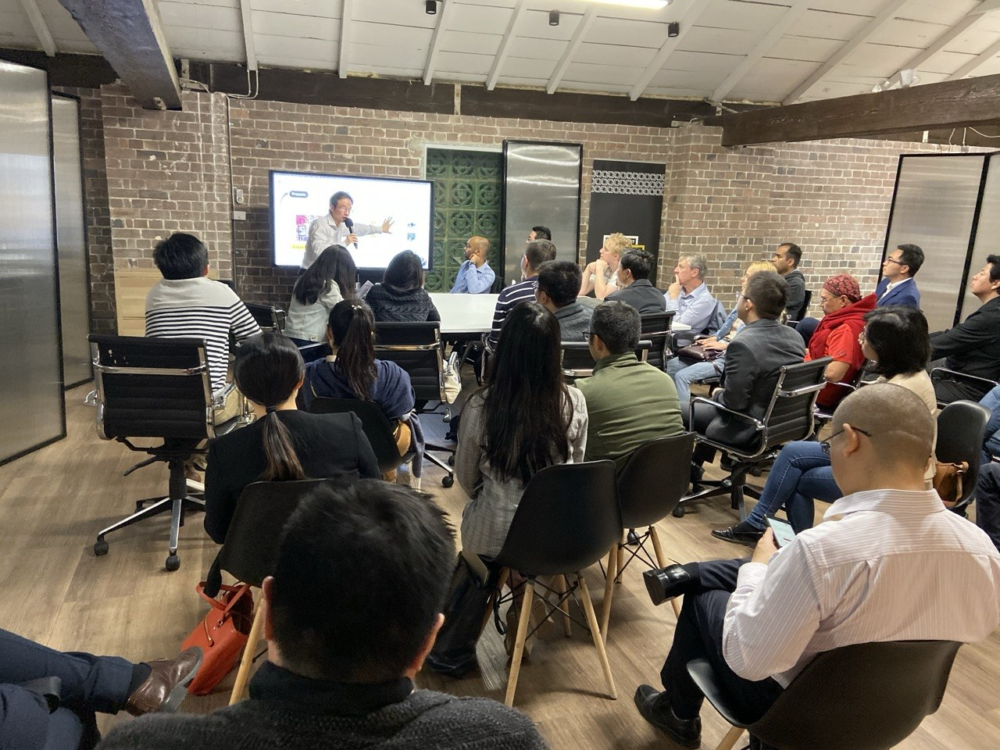

# Workshops

> Page title tag: **Request a Discovery Call | NextGenius**

## AI Agent, Machine Learning & Automation Workshops

**Practical, hands-on workshops that help teams understand and implement AI agents, MCP integrations, machine learning, and harness engineering for real business outcomes.**

## What you will learn

Our workshops are designed for teams that want practical experience with AI agents, automation, and connected systems. Each session combines theory, live demos, and hands-on activities tailored to your business context.

### AI Agent Design & Development

Learn how to design, build, and deploy AI agents that automate workflows, interact with business systems, and support real operational tasks. We cover agent architecture, prompt engineering, tool use, and integration patterns that produce reliable, outcome-driven assistants.
- Agent architectures and decision flows
- Task planning and multi-agent coordination
- Tool calling and external-system integration
- Evaluation, safety, and guardrails

### Machine Learning for Business

A practical introduction to machine learning concepts focused on business use cases. Understand when ML is the right approach, how to prepare data, and how to move from experiments to production-ready models that deliver measurable value.
- Supervised and unsupervised learning basics
- Feature engineering and data preparation
- Model training, validation, and deployment
- Monitoring and model lifecycle management

### MCP (Model Context Protocol)

Explore the Model Context Protocol that enables AI assistants to connect with external tools, APIs, and data sources. Learn how MCP standardises the way agents interact with business systems, databases, and third-party services.
- MCP architecture and server setup
- Building custom tools and resources
- Security, authentication, and access control
- Real-world integration patterns

### Agent Skills & Capability Design

Define what your AI agent can actually do. This session covers skill identification, capability scoping, and designing reliable agent behaviours so the assistant performs consistently across different business contexts.
- Skill mapping and capability matrices
- Prompt patterns for reliable execution
- Memory, context management, and state
- Testing and iterative improvement

### Harness Engineering

Harness Engineering covers the scaffolding, testing frameworks, and orchestration layers that keep AI agents reliable in production. Learn how to build evaluation harnesses, monitoring systems, and feedback loops that maintain quality as your agent scales.
- Evaluation frameworks and benchmarking
- Observability, logging, and tracing
- Feedback loops and continuous improvement
- Production deployment and rollback strategies

## Ready to upskill your team?

Book a discovery call and we will design a workshop that fits your team's goals, experience level, and business priorities.
Whether you are exploring AI for the first time or scaling an existing agent program, we will help you make practical progress fast.
[Book a Workshop](#/contact)
